<div align="center">

# Caio Gugê

**Mobile developer turning coffee into apps, one commit at a time ☕📱**

<sub>📍 Criciúma, SC · made in São Paulo 🇧🇷</sub>

</div>

```ts
const caio = {
  role: "Mobile Developer @ MS Sistemas",
  focus: ["mobile apps", "APIs", "the infra that keeps them running"],
  stack: {
    mobile: ["React Native", "Expo", "TypeScript"],
    web: ["Vue.js"],
    backend: ["Laravel", "PHP", "MariaDB", "Redis"],
    devops: ["Docker", "CI/CD", "self-hosted everything"],
  },
  currentlyLearning: ["real-time video (WebRTC)", "English 🇺🇸"],
  sideQuest: "MeuInvest 📈 — a simple app to track my stocks, REITs & crypto",
  askMeAbout: "anything. I'm curious and I like to help.",
};
```

<div align="center">

<picture>
  <source media="(prefers-color-scheme: dark)" srcset="./profile/top-langs-dark.svg" />
  
</picture>
<picture>
  <source media="(prefers-color-scheme: dark)" srcset="./profile/stats-dark.svg" />
  
</picture>

<br/><br/>

<picture>
  <source media="(prefers-color-scheme: dark)" srcset="./profile/snake-dark.svg" />
  
</picture>

<br/><br/>

<a href="https://www.linkedin.com/in/caioguge/"></a>
<a href="mailto:caioguge@gmail.com"></a>

</div>
